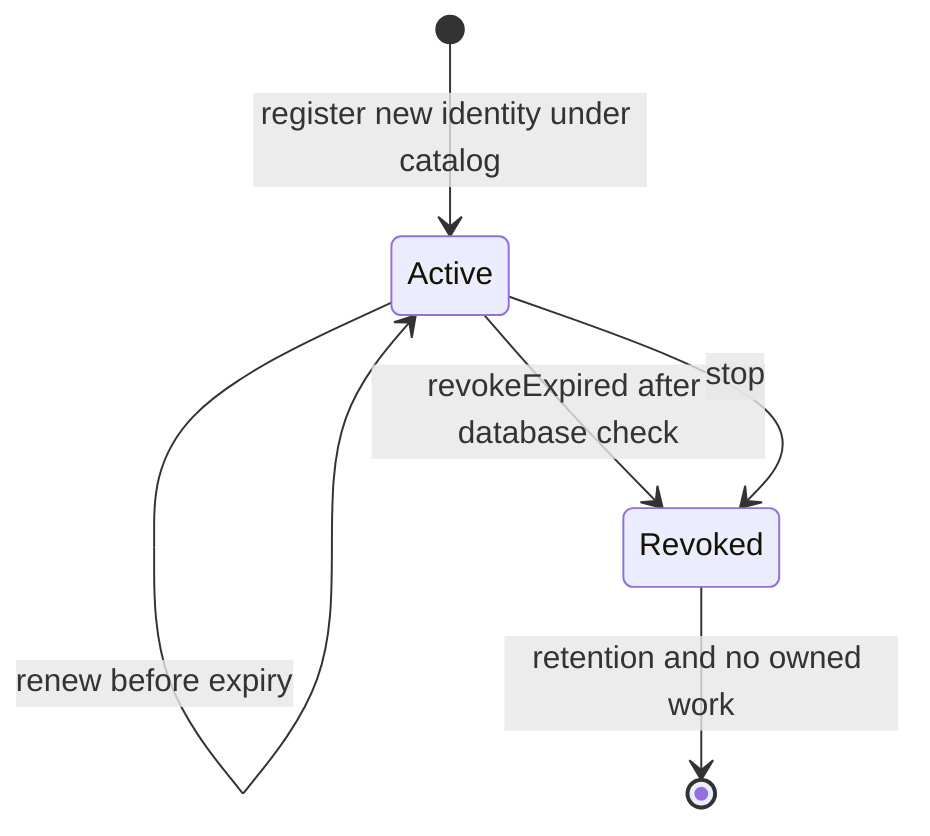

# Clustering, sessions and recovery

Status: Active · Last Reviewed: 2026-09-10 · Source of Truth: Repository

The relational database arbitrates ownership. Workers share a homogeneous executable catalog and use short transactions to publish sessions, acquire work, complete attempts and recover revoked owners. Handlers run outside those transactions.

## Session authority

Each process incarnation receives a canonical UUIDv7 `node_id`. `JdbcNodeStore.register` creates its durable session under the published catalog; repeating registration after an unknown response reconciles the same identity. Renewal is a separate operation. `renew` succeeds only while the stored session is unrevoked and unexpired according to a fresh database-time sample. A failed renewal does not revive the row: `NodeMembership` obtains a new identity for subsequent acquisitions.

`revokeExpired` locks the session and checks its current expiry using database time. A stale peer snapshot is only a reason to attempt this operation. It is not permission to reclaim work. If renewal wins first, revocation must evaluate the renewed expiry. Once revoked, a session cannot renew.

Expiry also blocks renewal before a peer physically marks the session revoked. Recovery requires that revocation; it never treats an arbitrary missing node ID from an old list as proof of death.

## Acquisition and fenced results

Every acquisition receives a fresh `claim_token`, including acquisition by the same node after admission deferral. An owned mutation must match all of:

- execution identity;
- session identity;
- claim token;
- attempt number.

Session validation, canonical job locks and the ownership predicate protect the transaction. A matching identity string alone is insufficient. Local cancellation signals, executor futures and the in-flight map are derived process state; they cannot grant database ownership.

Completion atomically decides ownership, writes the latest attempt, releases work for retry or marks it terminal, updates any batch counter and rearms an eligible fixed-delay series. A stale grant cannot apply any of those writes. The retained latest claim token can identify a repeated completion as `ALREADY_APPLIED`; older attempt tokens are not an indefinite receipt history.

A transaction may take time after its database decision. The relevant ordering is the session/job/work locks and their conditional transitions, not an assertion that the process stops at an exact wall-clock instant. Database timeouts bound normal waits; a network or driver that does not respond to cancellation can still outlive them.

## Failure sequences

| Sequence | Result |
| --- | --- |
| Two nodes acquire the same item | Locking selection and the guarded ownership transition allow one current grant. |
| A peer reads an expired session; its owner renews before revocation | Revocation rechecks the locked row and cannot revoke the renewed promise. |
| A worker resumes after revocation and recovery | Its old session/token cannot persist completion or return a newer owner's work. |
| An admission loser is returned and acquired again by the same session | The new token fences the earlier grant; the attempt number is unchanged because no handler ran. |
| A completion commits but its response is lost | Repetition can recognize the latest applied token. The caller must treat the first outcome as unknown, not as a confirmed rollback. |
| A handler performs an external effect and the process dies before completion | Recovery may execute the handler again. Database ownership does not deduplicate the external effect. |
| Recovery and heartbeat race | Both serialize on the session row; recovery proceeds only after irrevocable revocation. |
| A database outage exceeds session validity | Work stops making durable progress; successful reconnection cannot resurrect expired identities. Peers recover through the configured retry budget. |

Retries are finite unless a custom policy deliberately permits more. Exhausting the budget produces a terminal result; it does not prove that an external effect was absent. Cancellation is cooperative: it cannot undo an effect already committed elsewhere or forcibly stop arbitrary Java code.

## Shards and concurrency capacity

`Shards` derives assignment from current RUNNING sessions. Shards spread polling; they are not an ownership fence or a consensus election. Database arbitration remains necessary while membership changes. A cluster with more workers than shards leaves some workers without a polling partition.

`maxConcurrentExecutions` limits outstanding acquired work for each job key. Zero is unlimited. Positive limits are reserved under the definition lock and checked against durable occupancy inside the claim transaction. Recovery can conservatively hold capacity until abandoned work is resolved. This cap does not prevent an expired handler from continuing an external operation after a replacement worker acquires the job.

Different recurring definitions have different job keys and therefore different concurrency budgets, even when they share executable code. Use a shared rate-limit name when jobs consume the same throughput budget; it is a token bucket for admitted starts, not a distributed mutex for external effects.

## Lifecycle and time

A paused job suspends automatic triggers; already accepted work remains eligible. A paused node stops acquiring work while maintaining its session and local cancellation/timeout duties. Draining stops new acquisition and keeps servicing already submitted tasks within the configured lifecycle policy.

The normal idle sleep is capped by `node-lease-ttl / 3`. Long database waits, process pauses and saturated infrastructure can still cause expiry. Increasing TTL trades recovery delay against tolerance of pauses; it is not a correctness fix for unbounded application work.

Local duration checks use monotonic time. Session expiry, revocation and receipt expiry use database time. The configured engine clock is an estimate used for scheduling observations; its existence does not itself make every caller-provided timestamp authoritative. See [transactions](../04-engineering/transactions.md) and [types](../06-data/type-contract.md) for the actual store contracts.

Old session rows may be removed only after revocation, the retention cutoff and the absence of outstanding work. No epoch counter, nullable-expiry fallback or mixed-version liveness path is supported by the first-release schema.

Relevant implementation: `NodeMembership`, `JdbcNodeStore`, `JdbcSessions`, `JdbcCatalogStore`, `JdbcWorkQueue`, `JdbcLeaseStore` and `JdbcExecutionTransitions`. The controlled interleavings are covered by ownership, catalog, admission, cancellation and unknown-commit protocol tests across H2, PostgreSQL, MySQL and SQL Server; passing these tests does not certify an arbitrary deployment's failover or storage durability.
