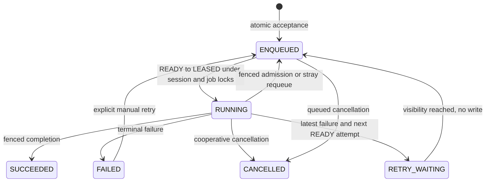

# Execution lifecycle

Status: Active · Last reviewed: 2026-09-10.

## Authoritative facts

| Public state | Committed representation |
|---|---|
| ENQUEUED | PENDING history and READY work; includes scheduled first attempts not yet visible |
| RETRY_WAITING | PENDING history and READY work with attempt > 1 and future visibility |
| RUNNING | PENDING history and LEASED work carrying node, token, attempt and claimed time |
| SUCCEEDED / FAILED / CANCELLED | Terminal history and no active work |

A single statement joins history to the active work row. Expiry alone does not make a grant disappear from this view: revocation and fenced recovery persist the transition. PENDING without active work is an invariant violation.

## Registration, submission and firing

Annotation and programmatic registration normalize to immutable definitions, explicit executable keys and typed input contracts. Startup reconciles that catalog before session entry. Retired definitions remain retired until explicit reactivation; acquired work retains executable identity.

Manual acceptance locks the active definitions and verifies input contracts. Receipt arbitration, optional batch creation, history snapshots and READY rows belong to the same transaction. On the same DataSource it can use a savepoint in the host transaction; callbacks wait for the host commit. A rollback leaves no accepted execution.

Automatic firing reads a bounded due page and uses the store's returned observation time for misfire planning. Requested horizons cannot exceed the database observation. The transaction checks revision, observed next fire, active/unpaused status and firing cutoff, then reads the input under the definition lock, advances the trigger and creates all occurrences. A competing update loses the CAS without creating duplicates. A crash before commit rolls the whole operation back; an unknown commit is resolved by the persisted trigger revision/time and occurrences.

A fixed-delay trigger disarms while its scheduled execution is active. Only a terminal completion from the matching scheduled revision rearms it. Manual enqueue/retry cannot accidentally rearm a recurrence through the audit actor string.

## Acquisition and dispatch

The coordinator round-robins its assigned shards and advances bounded pages of visible job keys. It reads policies in bulk, evaluates named windows/rate availability and claims only eligible candidates. Priority applies within the page/shard. A closed page cannot permanently hide later job keys.

The JDBC claim locks the session, samples database time, locks jobs canonically and rechecks live occupancy. Zero job capacity means unlimited; positive capacity is a strict ceiling on database acquisitions. It selects/locks work and issues a fresh token for every grant. Two workers cannot commit ownership of the same work row under the same state.

After claim, local admission rechecks windows and charges shared rate buckets once per resource group. A rejected item is fenced back to READY without consuming an attempt. A successful charge may be spent even if the process fails before invoking the handler. Unknown charge outcomes do not authorize dispatch.

Inputs and headers are loaded in one batch and decoded with the registered type. A query failure leaves grants for reconciliation; an incompatible input is a terminal diagnostic. The grant remains immutable throughout dispatch. Local timeout/cancellation signals are cooperative; ignoring interruption does not prolong database ownership.

## Completion, cancellation and retry

Completion validates session/grant authority and matches execution, node, token and attempt. Latest result, retry or terminal work state, batch counters and fixed-delay rearm commit together. Replaying an already committed result returns ALREADY_APPLIED without applying counters again. A stale grant cannot complete a later acquisition.

Queued cancellation deletes READY work and records terminal cancellation atomically. For LEASED work it persists an intent and signals the handler when observed. That intent prevents a concurrent failure from scheduling another retry or requeue. A completed success is allowed to win; a cancel request cannot undo a side effect already performed.

Automatic retries reuse the immutable input and increment the attempt. Manual retry applies to retained FAILED executions of active definitions, preserves input/history identity and becomes a standalone MANUAL execution for rearm purposes. It races through an atomic state transition, not an unchecked read followed by insert.

Batch counters count terminal members. Retried failures do not decrement pending early. Only the transaction that brings pending to zero returns the batch closer. Listener events remain best effort; durable counters are not an exactly-once event delivery mechanism.

## Recovery and unknown outcomes

Recovery first revokes an expired session atomically. A heartbeat that renews first prevents revocation; a revoked identity cannot renew later. Recovery then uses the observed grants and the same fencing protocol as completion, applying cancellation and retry policy. Concurrent heartbeat/recovery snapshots are not authority by themselves.

Own stray grants are reconciled separately when there is neither an in-flight local incarnation nor a completion in transit, after a grace period. Fenced requeue protects against a completion or reacquisition that won meanwhile.

A timeout or connection loss around commit is an unknown outcome. Acceptance receipts, completion replay and durable trigger state resolve the corresponding database operation; a caller must not infer rollback from the exception. If an external effect happened but completion was not persisted, a later attempt may repeat it. Mohs does not provide exactly-once external execution. Business idempotency or target-side fencing must cover that boundary.

## Progress and resource budgets

One monotonic node-TTL/4 deadline covers a coordinator round. Each stage advances a persistent cursor before running, so expensive recovery or cleanup leaves later stages first in subsequent rounds. Cadenced metrics/retention consume their slot only when attempted. A database call already in progress can overrun the checkpoint; SQL/transaction deadlines and session revocation remain separate controls.

Dispatch headroom, completion batching, candidate pages and retry backoff bound particular operations; none makes the backlog bounded. Sustained arrivals above completion capacity increase queue age. Repeated database outages or infinite/non-cooperative user work can prevent timely progress. See [clustering](clustering-and-liveness.md), [transactions](../04-engineering/transactions.md) and the [measurement harnesses](../10-performance/benchmarks.md).
