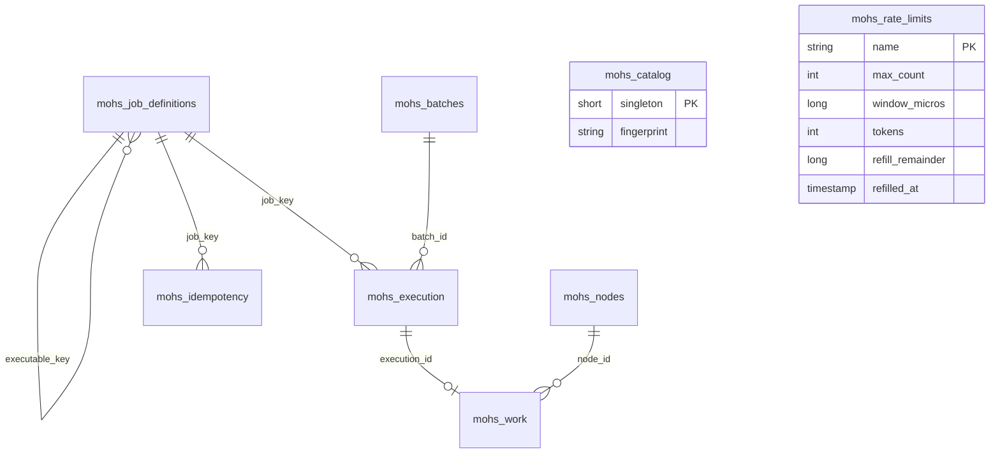

# Data model

Status: Active · Last reviewed: 2026-09-10 · Source of truth: the four canonical JDBC installers.

Mohs uses **eight tables**, all prefixed `mohs_` because the library shares its application's database. The [installers](schema.md) define the current layout; work and retained execution snapshots have separate tables and indexes.

The executable self-reference is a declared foreign key. The execution, work, session, receipt and batch links are logical relationships maintained by complete transactions. In particular, a receipt may survive removal of its execution history; there is deliberately no cascading history-to-receipt relationship.

| Table | Identity and cardinality | Authority and write profile | Lifetime |
|---|---|---|---|
| `mohs_catalog` | Exactly one row, `singleton = 1` | Serializes catalog publication and session entry, including an empty installation | Installation |
| `mohs_job_definitions` | `job_key` PK; one executable or named recurrence per key | Policy, binding, current recurring input, pause/retirement, trigger and schedule revision | Retained after retirement |
| `mohs_work` | `execution_id` PK; exactly one per active execution | READY or LEASED; claim, requeue and retry update the same row; terminal completion deletes it | Active work only |
| `mohs_execution` | `execution_id` PK | Immutable input snapshot and origin; latest completed attempt and terminal outcome | Configurable terminal-history retention |
| `mohs_idempotency` | `(job_key, idempotency_key)` PK | Original acceptance receipt and fixed expiry; unique insertion arbitrates submissions | Independent expiry, or indefinite when configured |
| `mohs_nodes` | UUIDv7 `node_id` PK per process session | State, last heartbeat, expiry and irreversible revocation | Until revoked, old and without outstanding grants |
| `mohs_batches` | UUIDv7 `id` PK | Total members and terminal success/failure counters, updated in completion transactions | Until no member history remains and retention permits removal |
| `mohs_rate_limits` | Technical `name` PK | Capacity, refill window, balance and fractional credit; conditional charging/configuration | Declared resource |

## Definitions and input snapshots

`job_key` is the only definition identity. Every definition has a non-null `executable_key` and `input_contract`. An executable binds to itself and has no stored recurring input. A named recurrence binds directly to an executable and stores its current input JSON. Chains of recurrences are rejected. Annotation and programmatic registration produce this same model.

`ck_mohs_job_input` represents these two shapes; there is no null legacy binding shape. The local catalog resolves Java code and input classes. Class names are not persisted to select a handler or decoder.

Policy includes schedule, runner/window/rate names, misfire policy, retries, timeout and an optional named retry policy. `max_concurrent_executions = 0` means unlimited; a positive value is the global acquisition ceiling. `start_paused` is initial policy; `paused` and `retired` are durable controls. There is no second allow-concurrency boolean or persistent orphaned flag.

`next_fire_at` and `schedule_revision` identify the automatic series. Changed schedules and reactivation create a new revision. A completion from an older series cannot rearm the replacement. An on-demand definition, or a fixed-delay series awaiting its execution, has no armed next fire.

Updating recurring JSON affects later occurrences only. Firing locks the definition and reads the current JSON in the transaction that advances its trigger and creates occurrences. The execution retains that snapshot throughout queueing, retries and history. Metadata queries omit recurring JSON; the dispatcher loads execution inputs in a batch.

## Active work

Every `mohs_work` row has identity, job key, shard, priority and one-based attempt number. Its state constraint permits exactly these shapes:

| State | Required fields | Absent fields | Meaning |
|---|---|---|---|
| READY | `visible_at` | node, claim token and claimed time | Eligible when visibility is reached; no pending cancellation flag |
| LEASED | `node_id`, `claim_token`, `claimed_at` | `visible_at` | Owned by that exact session/grant; cancellation may be requested |

A claim checks database time and session validity, locks candidate jobs in canonical order, rechecks global occupancy and changes selected READY rows to LEASED. Every grant gets a fresh UUIDv7 token, including reacquisition of the same attempt. Completion and recovery match execution, node, token and attempt.

Terminal completion removes work and updates history atomically. Retry updates work back to READY and records the completed attempt in history. A concurrent cancel request suppresses retry/requeue inside the winning transaction. A successful handler result may still win over a cooperative cancel request. Retirement cancels queued work; an already acquired snapshot may finish, while retry is suppressed if its definition remains retired.

The coordinator reads at most 128 visible job identities per shard page, loads their policies in bulk and supplies a positive eligible-job filter. Cursors advance through closed windows. Priority applies inside that page and shard; it is not global FIFO. The database still decides capacity under job locks.

## Execution and latest attempt

An execution stores `payload`, `input_contract`, scheduling/audit metadata, `batch_id`, and explicit `origin`. MANUAL executions have no schedule revision; SCHEDULED executions carry the positive revision that created them. `actor` is audit text and does not determine rearm behavior.

The stored nonterminal outcome is PENDING. Read models derive ENQUEUED/RETRY_WAITING/RUNNING from the single joined work row. A PENDING execution without a valid work row is an invariant violation, not a fabricated queue state. A single read sees the committed state on either side of completion.

`last_attempt_*` and `last_claim_token` describe only the latest completed attempt and permit recognition of repeated completion after an uncertain commit. Retry does not erase that result. No `mohs_attempt` table or list of past attempts exists. Terminal outcome, fixed-delay rearm and batch counters commit with the work transition.

## Types, cost and installation

See the [type contract](type-contract.md): canonical UUIDv7 strings have width 36; technical names use exact ASCII comparison; instants use UTC microseconds; durations and batch counters use BIGINT. The Java/JDBC boundary normalizes types before SQL. JSON is a typed job snapshot, not a replacement for relational scheduling state.

Work indexes grow with active work rather than retained history. That structural separation does not make runtime performance independent of history: shared cache, storage, writes and history queries can still compete. Fewer tables did not improve every measured workload.

The [installers](migrations.md) define one fresh schema per database. V14/V15 explain historical changes; they are not upgrade paths in this unreleased version. Tables `mohs_job_bindings`, `mohs_attempt`, `mohs_ready` and `mohs_lease` are absent from the current installer.
